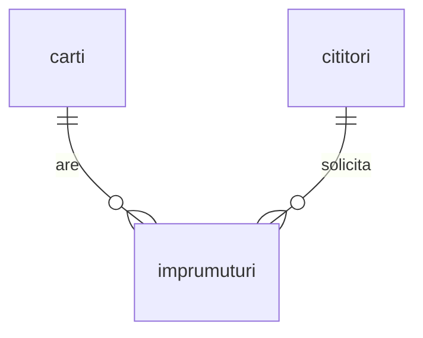

# SQL to Kubernetes Lab

Laborator practic în română: învață SQL și administrarea bazelor de date construind o bibliotecă, apoi evoluează spre containere și Kubernetes.

**Stadiu: prima etapă PostgreSQL.** Modulele MySQL, API, Docker și Kubernetes sunt planificate; nu sunt încă implementate.

## Ce construim

O bibliotecă cu cărți, cititori și împrumuturi. Toate persoanele și datele de contact sunt fictive. Fiecare rând din `carti` reprezintă un exemplar fizic.



## Cerințe

- Ubuntu 24.04 sau un mediu Linux cu Bash.
- PostgreSQL 16 și clienții `psql`, `pg_dump`, `pg_restore`.
- Git; acces administrativ doar la instalare și crearea conturilor/bazelor.
- Pentru această etapă: aproximativ 2 GB RAM și 2 GB spațiu liber pentru exerciții mici, suplimentar sistemului de operare.

Pe Ubuntu, dacă lipsesc pachetele:

```bash
sudo apt update
sudo apt install git postgresql postgresql-contrib
```

## Pornire pas cu pas

Comenzile de mai jos se rulează în terminalul Linux, din folderul proiectului.

```bash
git clone https://github.com/mihaistanciu1984/sql-to-kubernetes-lab.git
cd sql-to-kubernetes-lab
sudo -u postgres createuser --pwprompt library_owner
sudo -u postgres createdb --owner=library_owner library_lab
export PGHOST=127.0.0.1 PGPORT=5432 PGUSER=library_owner PGDATABASE=library_lab
psql -X -v ON_ERROR_STOP=1 -1 -f schema.sql -f seed.sql
psql -X -v ON_ERROR_STOP=1 -f verify.sql
```

Alege o parolă proprie la `createuser`. Clientul o va cere la conectare. Nu o pune în repository. Contul nou nu este superutilizator și nu poate crea alte baze sau roluri. Comenzile de inițializare sunt pentru o bază **nouă, goală**; nu șterg tabele existente și vor eșua dacă schema există deja.

Rezultat așteptat: 4 cărți, 3 cititori, 3 împrumuturi, dintre care 2 active. Verificarea se termină cu `Verificari OK`. Dacă ai creat deja utilizatorul/baza, sari acele comenzi și verifică proprietarul cu administratorul.

Continuă cu [exercițiile](EXERCITII.md), apoi cu [backup și restaurare](BACKUP.md) și [utilizatorul cu drept de citire](PERMISIUNI.md). Soluțiile sunt în [solutii.sql](solutii.sql), iar rezultatele testării în [VALIDARE.md](VALIDARE.md).

## Diagnostic rapid

| Mesaj | Verificare |
|---|---|
| Connection refused | `pg_lsclusters` și `systemctl status postgresql` |
| Password authentication failed | Contul PostgreSQL și parola sa; parola Linux/MySQL este independentă |
| Database does not exist | Execută `createdb` și verifică numele bazei |
| Permission denied for schema | Conectează-te cu proprietarul `library_owner` |
| Relation already exists | Schema este deja încărcată; nu relansa inițializarea |

Pe Hyper-V, pentru o adresă stabilă în LAN folosește un switch extern și o rezervare DHCP pe router. Default Switch poate schimba subrețeaua. PostgreSQL poate rămâne accesibil doar local; pentru lucru de la distanță folosește SSH către server.

## Parcursul proiectului

- [x] Schema PostgreSQL, date fictive și verificări automate.
- [x] Zece exerciții SQL cu soluții.
- [x] Procedură și scripturi backup/restore într-o bază separată.
- [x] Rol de citire și teste manuale de permisiuni.
- [ ] Modul comparativ MySQL.
- [ ] API pentru bibliotecă și teste.
- [ ] Docker Compose cu volume persistente.
- [ ] Kubernetes local: Deployment, Service, StatefulSet, PVC și Secret.
- [ ] Recuperare după defecțiuni și verificări automate în GitHub Actions.

Acesta este un laborator educațional. Configurația pentru producție, disponibilitatea ridicată și monitorizarea vor fi tratate separat.

## Contribuții

Deschide un issue cu obiectivul lecției sau eroarea, comenzile folosite și versiunea PostgreSQL. Elimină parolele și datele personale. Pentru modificări, propune un pull request cu pași de verificare și rezultate așteptate.
